# Secure Enterprise Cloud Storage on AWS with Cross-Region Disaster Recovery

## Project Overview

This project demonstrates a secure cloud storage solution using Amazon Web Services (AWS). It uses Amazon S3 for private object storage, versioning, lifecycle management, and cross-region disaster recovery.

The primary private storage bucket is hosted in Tokyo (`ap-northeast-1`), with a separate private disaster recovery (DR) bucket in Mumbai (`ap-south-1`). Amazon S3 Cross-Region Replication (CRR) is configured to replicate eligible objects from the primary bucket to the DR bucket.

A separate S3 bucket hosts a public static website for demonstration purposes. Public website hosting is kept separate from private storage.

## Project Objectives

- Configure private object storage using Amazon S3.
- Enable S3 versioning to preserve object versions.
- Implement lifecycle management to transition eligible objects to a lower-cost storage class.
- Configure cross-region replication for disaster recovery.
- Apply IAM permissions to control access to private storage.
- Separate public website hosting from private document storage.

## AWS Services Used

- **Amazon S3:** Object storage for website content and private files.
- **S3 Static Website Hosting:** Hosts a public demonstration website.
- **S3 Block Public Access:** Helps protect private storage buckets from public access.
- **S3 Versioning:** Maintains multiple versions of objects.
- **S3 Lifecycle Management:** Transitions eligible current object versions to S3 Standard-IA after 30 days.
- **S3 Cross-Region Replication (CRR):** Replicates eligible objects across AWS Regions.
- **AWS Identity and Access Management (IAM):** Controls user access through a custom policy.
- **Default S3 Encryption:** Enabled on the private storage buckets.

## Architecture Diagram

The architecture illustrates the separation of public website hosting from private storage, IAM-controlled access, and cross-region disaster recovery between Tokyo and Mumbai.

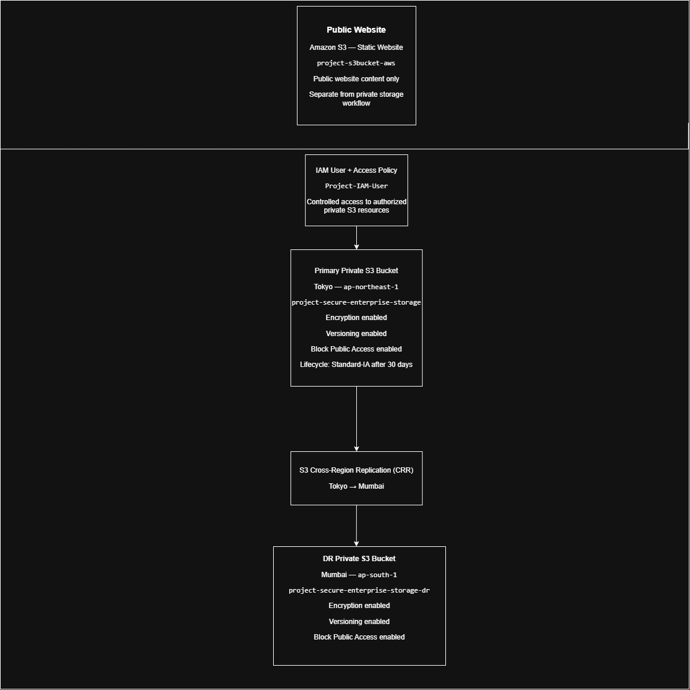

### Architecture Overview

- **Public website:** A standalone S3 static website bucket for demonstration purposes.
- **IAM access control:** An IAM user and custom policy for authorized access to private S3 resources.
- **Primary storage:** A private S3 bucket in Tokyo (`ap-northeast-1`) with encryption, versioning, and lifecycle management.
- **Disaster recovery:** S3 Cross-Region Replication from the primary bucket in Tokyo to the private DR bucket in Mumbai (`ap-south-1`).

## Resources

The project uses the following storage and replication flow:

**Private S3 Bucket — Tokyo → Cross-Region Replication → Private S3 Bucket — Mumbai**

The public static website is hosted separately.

| Resource | Purpose | Region |
|---|---|---|
| `project-s3bucket-aws` | Public static website | Tokyo |
| `project-secure-enterprise-storage` | Private primary storage | Tokyo |
| `project-secure-enterprise-storage-dr` | Private DR storage | Mumbai |
| `Project-IAM-User` | Controlled access to S3 resources | Global IAM service |
| `SecureEnterpriseS3Access` | Custom IAM access policy | Global IAM service |
| `SecureStorageLifecycleRule` | Lifecycle transition configuration | Primary bucket |
| `SecureStorageCrossRegionReplication` | Cross-region replication rule | Primary bucket |

**AWS Regions**

- Tokyo: `ap-northeast-1`
- Mumbai: `ap-south-1`

## Implementation Steps

### 1. Public Static Website

- Created an S3 bucket named `project-s3bucket-aws` in Tokyo.
- Enabled static website hosting.
- Uploaded website content and tested website access.
- Kept the website bucket separate from private storage.

### 2. Private Primary Storage

- Created `project-secure-enterprise-storage` in Tokyo.
- Kept Block Public Access enabled.
- Enabled default encryption and versioning.

### 3. Disaster Recovery Bucket

- Created `project-secure-enterprise-storage-dr` in Mumbai.
- Kept the bucket private.
- Enabled default encryption and versioning.

### 4. IAM Access Control

- Created the `Project-IAM-User` IAM user.
- Configured the custom `SecureEnterpriseS3Access` policy.
- Tested access to the intended private storage resources.
- Applied permissions for the required S3 operations.

### 5. Versioning and Delete-Marker Testing

- Enabled versioning on the private storage buckets.
- Tested object versioning and delete-marker behavior.
- Used separate object names for testing, including `project-info.txt` and `projecy-info.txt`.

### 6. Lifecycle Management

- Created and enabled `SecureStorageLifecycleRule`.
- Configured eligible current object versions in the primary bucket to transition to S3 Standard-IA after 30 days.
- Did not configure an object-expiration action.

### 7. Cross-Region Replication

- Created and enabled `SecureStorageCrossRegionReplication` from Tokyo to Mumbai.
- Uploaded and checked a test object in the destination bucket.
- Verified that the tested source object's replication status showed `COMPLETED`.

## Validation Results

| Feature | Validation |
|---|---|
| Static website | Configured and tested |
| Private primary bucket | Security settings configured |
| Private DR bucket | Created and configured |
| IAM user permissions | Tested successfully for intended access |
| Versioning | Enabled and tested |
| Delete-marker behavior | Tested |
| Lifecycle management | Rule enabled; transition is scheduled after 30 days |
| Cross-region replication | Replication confirmed for the tested object |

**Validation note:** The `COMPLETED` replication status confirms replication for the specific object tested. It does not confirm that every object in the primary bucket has been replicated. Existing objects uploaded before replication was enabled may require separate replication actions.

## Security Considerations

- Keep private storage buckets private and Block Public Access enabled.
- Use IAM permissions that grant only the access required for the task.
- Keep the public website bucket separate from private files.
- Never upload AWS access keys, secret keys, passwords, private keys, or session tokens to GitHub.
- Review account identifiers and other sensitive details before publishing screenshots.

This is a learning project and has not been presented as a production-ready architecture.

## Cost Considerations

AWS charges may apply for storage, requests, retrievals, lifecycle transitions, and cross-region data transfer. S3 Standard-IA may also have minimum storage-duration and retrieval charges.

Review current AWS pricing and remove resources that are no longer required.

## Repository Structure

```text
Secure Enterprise Cloud Storage & Disaster Recovery Using AWS S3/
├── README.md
├── .gitignore
├── architecture.png
├── index.html
├── project-info.txt
└── screenshots/
    ├── s3-buckets-overview.png
    ├── public-s3-website-bucket-objects.png
    ├── primary-s3-bucket-objects.png
    ├── lifecycle-and-replication-rules.png
    ├── dr-s3-bucket-objects.png
    ├── iam-user-permissions.png
    ├── iam-custom-policy-permissions.png
    ├── s3-versioning-and-delete-marker.png
    ├── static-website-live-demo.png
    ├── iam-user-private-s3-access.png
    └── iam-user-dr-bucket-access.png
```

## Screenshots

The following screenshots document the AWS resources, security configurations, access controls, and testing performed during this project.

### 1. S3 Bucket Overview

Overview of the three S3 buckets used in the project.

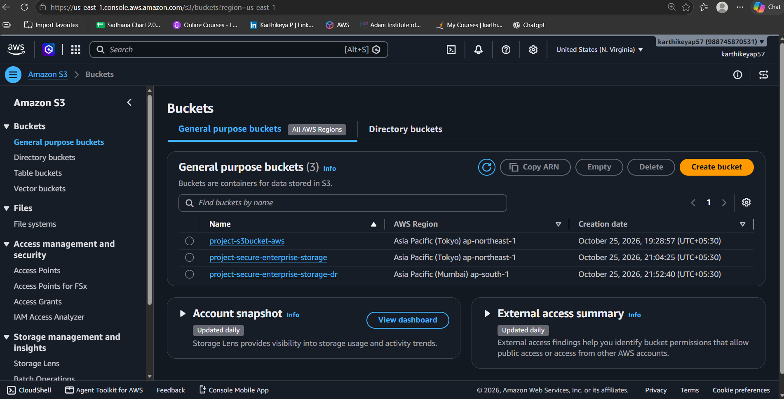

### 2. Public Static Website — Bucket Objects

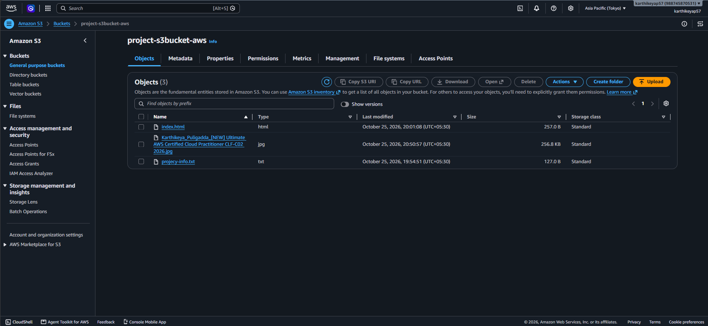

### 3. Primary Private S3 Bucket — Objects

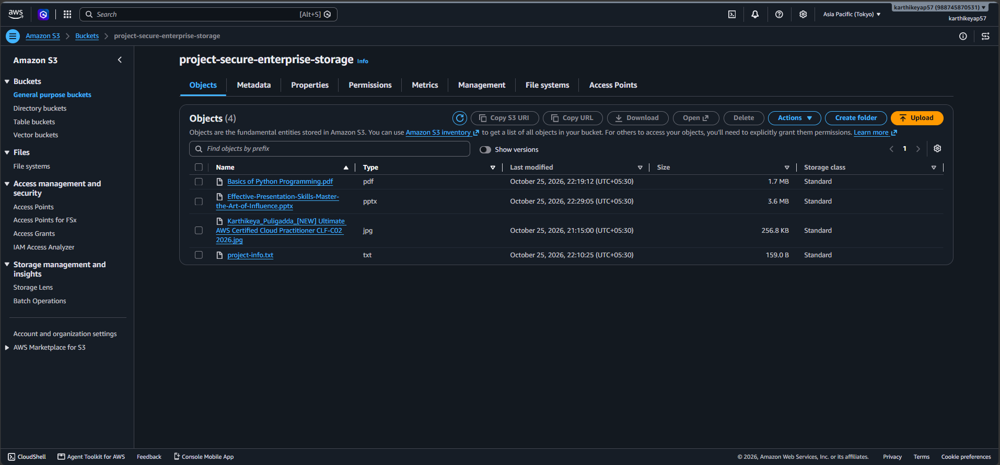

### 4. Lifecycle Management and Cross-Region Replication

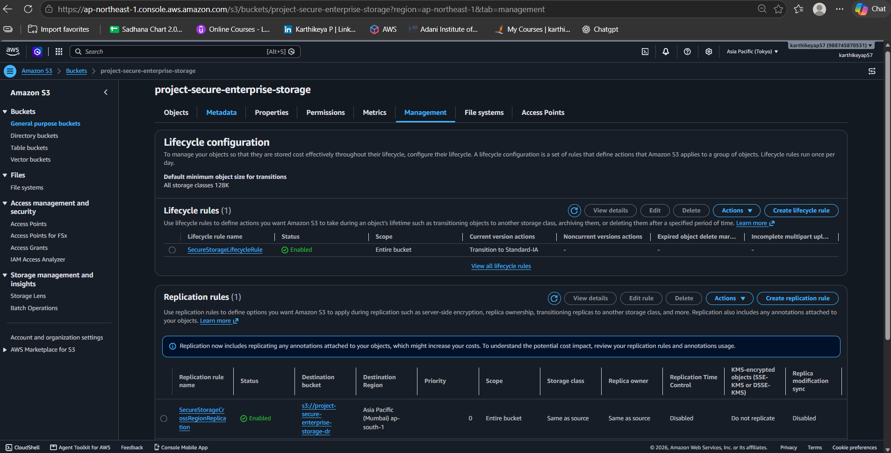

### 5. Disaster Recovery S3 Bucket — Objects

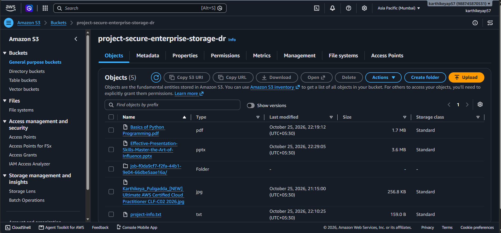

### 6. IAM User Permissions

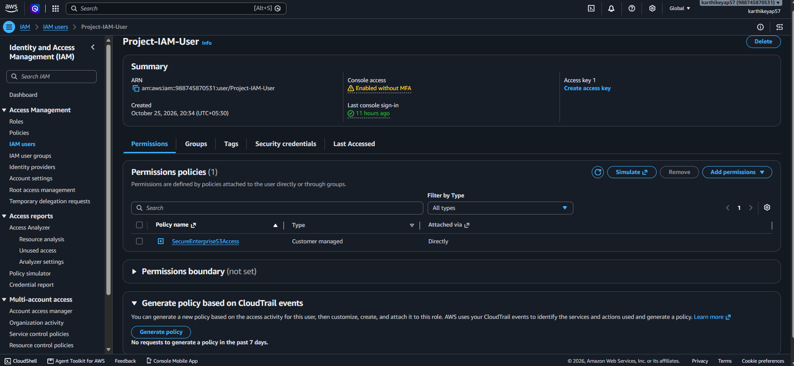

### 7. IAM Custom Policy Permissions

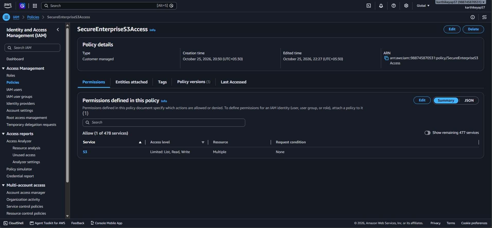

### 8. S3 Versioning and Delete-Marker Testing

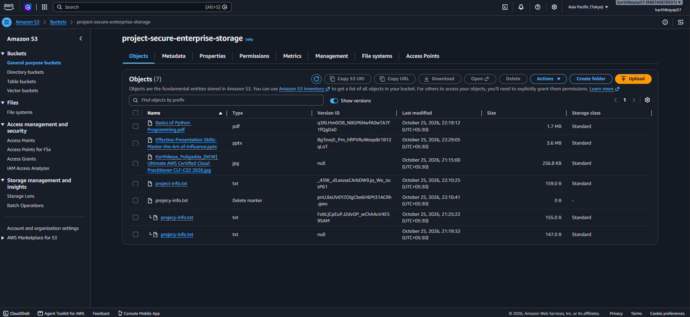

### 9. Live Static Website Demonstration

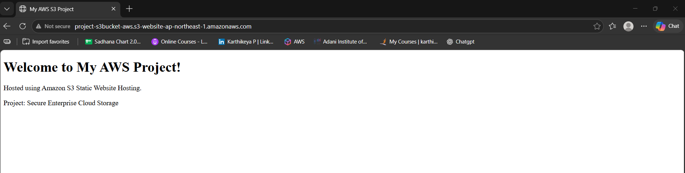

### 10. IAM User Access to the Primary Private Bucket

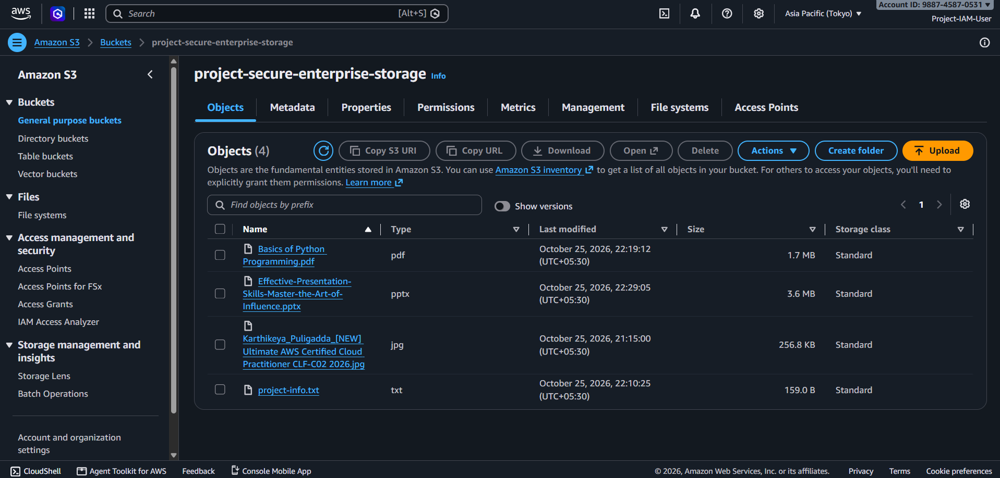

### 11. IAM User Access to the DR Bucket

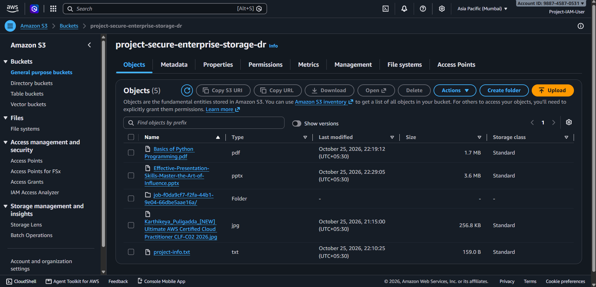

**Replication validation note:** The replication rule is enabled, and successful replication was verified for the tested object. These screenshots do not establish that every object has replicated.

## Future Improvements

- Add monitoring and alerts for replication failures.
- Document and test recovery procedures using the DR bucket.
- Introduce Terraform for infrastructure as code in a future project iteration.
- Add automated checks and operational documentation.

## Key Learnings

- Configuring public and private S3 use cases separately.
- Using IAM policies to control access to cloud resources.
- Understanding object versioning and delete markers.
- Applying lifecycle rules for storage cost management.
- Configuring cross-region replication for disaster recovery.

## Author

**Karthikeya Puligadda**

This repository documents an educational AWS project. The implementation and validation statements reflect the resources tested during the project and do not constitute a production security assessment.
